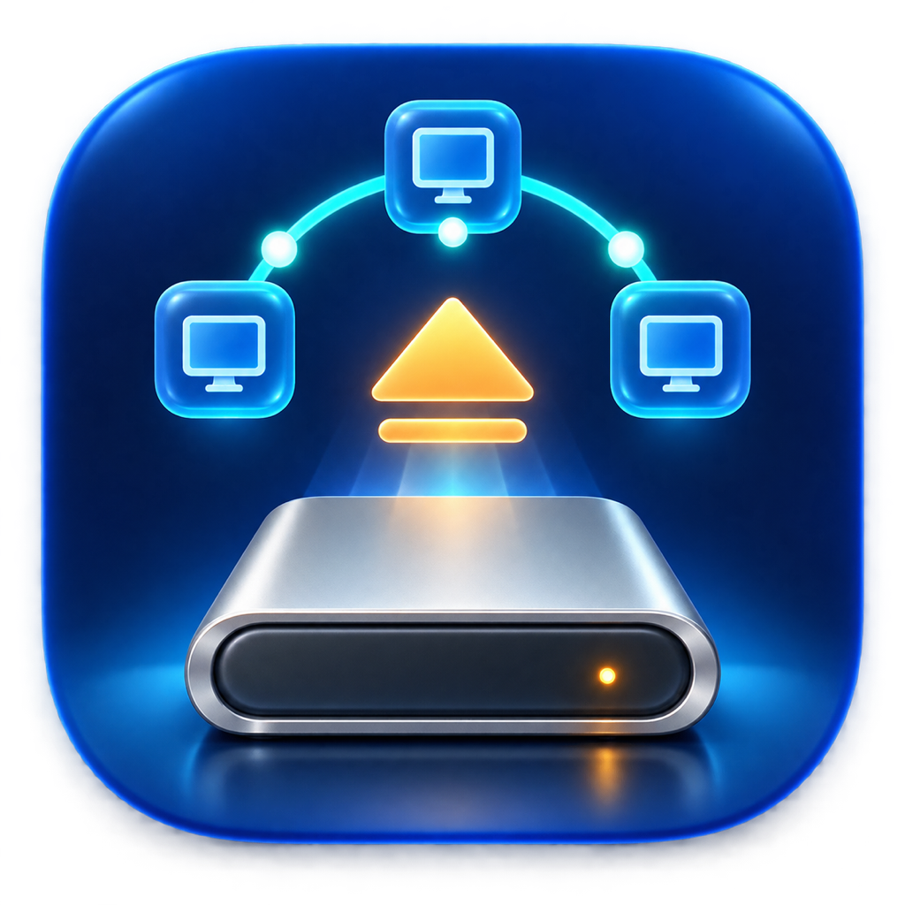

<p align="center">
  
</p>

# MountPilot

MountPilot is a small native macOS menu-bar utility that connects your network
shares after login and safely unmounts clone backup drives—unless a backup is
already running.

## Features

- Connects configured SMB, AFP, and NFS shares silently after login, using
  passwords already saved in Keychain
- Automatically detects active Time Machine backups
- Uses Carbon Copy Cloner's official task-status command when CCC is installed
- Supports configurable process-name guards for other backup applications
- Rechecks backup status before each clone volume
- Never force-unmounts a disk; macOS and backup software always retain a veto
- Stores network credentials in Finder/Keychain, not in MountPilot
- Runs quietly from the menu bar and can launch automatically at login

## Requirements

- macOS 13 Ventura or newer
- Apple silicon or Intel Mac

## Install

1. Download `MountPilot-1.2.zip` from the
   [latest release](https://github.com/zhvz4k8p69-beep/MountPilot/releases/latest).
2. Unzip it and move **MountPilot.app** to `/Applications`.
3. Open MountPilot. Its settings window appears on first launch.
4. Add one network share per line, such as `smb://nas.local/Media`.
5. Add each clone drive's exact Finder volume name, such as `Clone Backup`.
6. Enable **Launch at login** and click **Save**.

The current community build is locally signed but not notarized. If macOS says
it cannot verify the developer, Control-click MountPilot in `/Applications`,
choose **Open**, and confirm **Open** once. Subsequent launches work normally.

Shares connect in the background with the password saved in Keychain, so no
dialog appears at login. The first time a server has no saved password,
MountPilot opens Finder's normal credential prompt instead; enter the password
there and tick **Remember this password in my keychain**. Every later
connection is silent.

## Safety model

MountPilot is deliberately conservative. Before touching a clone volume it:

1. verifies that Time Machine reports no active backup;
2. asks Carbon Copy Cloner whether any task is running, when CCC is installed;
3. checks any additional process-name guards you configured; and
4. requests a normal, non-forced unmount through `diskutil`.

If a status cannot be verified, a backup is active, or macOS reports that the
disk is busy, MountPilot leaves the disk mounted and explains why in **Recent
activity**. It does not automatically retry later in the login session; use
**Run Now** when you are ready.

## Build from source

MountPilot is built with SwiftUI and has no third-party runtime dependencies.
The Xcode project is generated from `project.yml` using
[XcodeGen](https://github.com/yonaskolb/XcodeGen).

```sh
brew install xcodegen
xcodegen generate
xcodebuild \
  -project MountPilot.xcodeproj \
  -scheme MountPilot \
  -configuration Release \
  build
```

Run the tests with:

```sh
xcodebuild \
  -project MountPilot.xcodeproj \
  -scheme MountPilot \
  -destination 'platform=macOS' \
  test
```

## Privacy

MountPilot has no analytics, accounts, advertisements, or network service of its
own. Its preferences contain share addresses, volume names, startup delay, and
optional process-name guards. Passwords remain under macOS Keychain control;
MountPilot never reads them itself but asks the system's NetFS framework to
connect with whatever Keychain has saved.

## License

MountPilot is available under the [MIT License](LICENSE).
